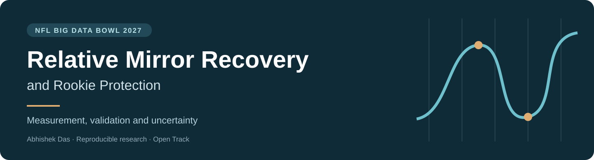
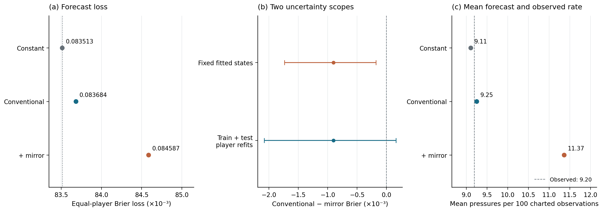
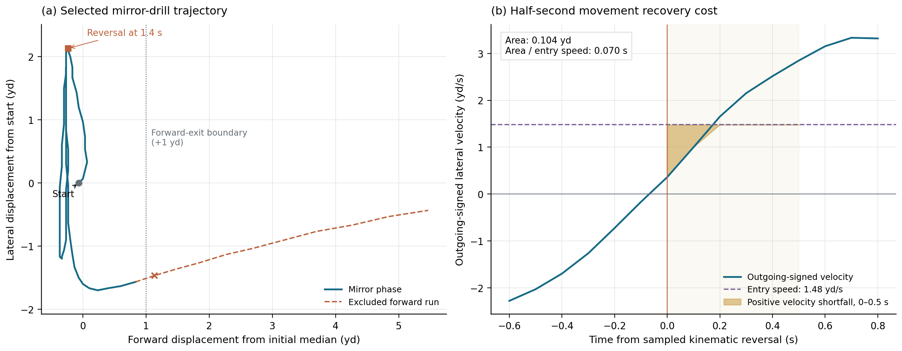
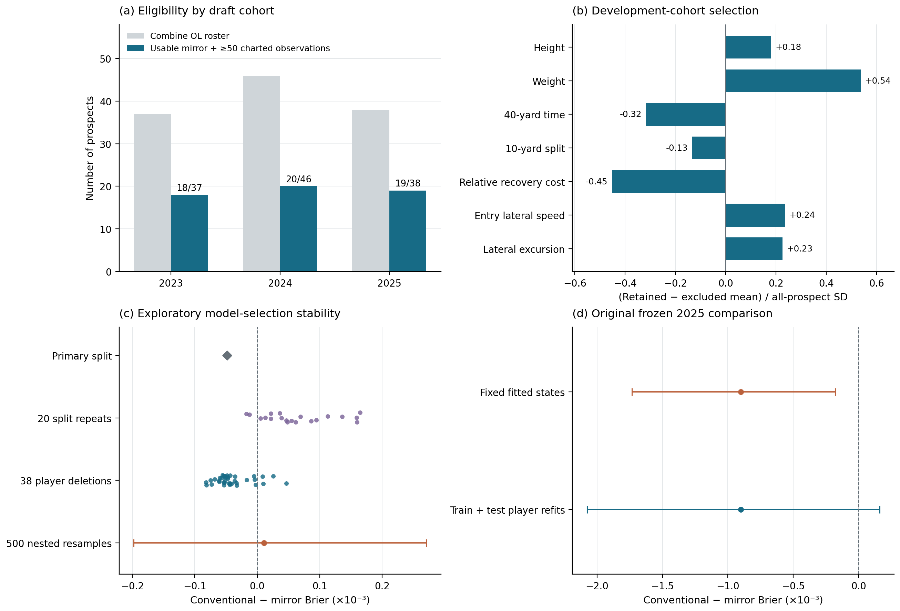
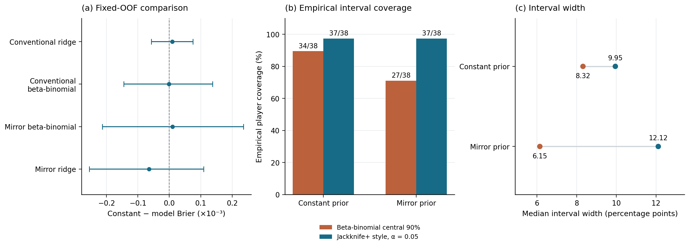

<p align="center">
  
</p>

<p align="center">
  <strong>Movement measurement. Honest validation. Explicit uncertainty.</strong><br>
  A reproducible study of Combine mirror drills and rookie offensive-line protection.
</p>

<p align="center">
  <a href="paper/technical-paper.pdf">Read the paper</a> ·
  <a href="notebooks/technical-paper.ipynb">Explore the notebook</a> ·
  <a href="https://www.kaggle.com/code/abhishekd2512/relative-mirror-recovery-and-rookie-protection">Run on Kaggle</a> ·
  <a href="docs/REPRODUCIBILITY.md">Reproduce the study</a>
</p>

# Relative Mirror Recovery and Rookie Protection

**Can lateral movement in the Combine mirror drill improve a rookie offensive lineman’s charted pressure forecast beyond conventional Combine measurements?**

The original frozen 2025 evaluation says **no**. Adding mirror descriptors worsened equal-player Brier loss; the development-mean constant performed best. This repository preserves that result and the subsequent exploratory work on functional curves, nested model selection, count-aware uncertainty, and task support.

The contribution is an **auditable movement measurement and film-review workflow**, accompanied by clear limits on forecasting and player ranking.

> **Author:** Abhishek Das · **Competition:** NFL Big Data Bowl 2027 · **Track:** Open Track  
> **Kaggle execution:** Version 5 completed successfully in **301.8 seconds** on October 9, 2026.

## Start here

| If you want to… | Open |
| --- | --- |
| Read the seven-page technical paper | [Technical paper PDF](paper/technical-paper.pdf) |
| Follow the paper and its executable appendix | [Portable notebook](notebooks/technical-paper.ipynb) |
| Inspect the previously delivered local execution | [Executed notebook](notebooks/technical-paper-executed.ipynb) |
| Read the article directly on GitHub | [Paper manuscript](paper/manuscript.md) |
| See the Kaggle-formatted writeup | [Kaggle writeup](paper/kaggle-writeup.md) |
| Understand execution, data, and verification | [Reproduction guide](docs/REPRODUCIBILITY.md) |
| Inspect code without opening a notebook | [Readable source](src/) |
| Trace preserved files and publication status | [Provenance](docs/PROVENANCE.md) · [Validation](docs/VALIDATION.md) |

## The main result

The historical test comprises **19 rookies, 7,801 charted observations, and 668 pressures**. Lower Brier loss is better. Each player receives equal weight.

| Original frozen 2025 forecast | Equal-player Brier loss |
| --- | ---: |
| Development-mean constant | **0.083513** |
| Conventional Combine measurements | 0.083684 |
| Conventional measurements + mirror profile | 0.084587 |

Mirror improvement, defined as conventional minus mirror loss, was **−0.000902**. The fixed-state 95% player-bootstrap interval was **[−0.001734, −0.000179]**; a train-plus-test player-refit interval was **[−0.002077, +0.000160]**. These intervals represent different uncertainty scopes. Neither repeats the historical human model search or accounts for shared-game dependence.



*Figure 2 in the paper. The original unfavorable result is retained throughout the research extension.*

## What the movement profile measures

For each usable lateral reversal, the analysis integrates velocity shortfall over the next 0.5 seconds and normalizes by incoming lateral speed. The resulting quantity measures **effective seconds of speed-relative movement loss**. It is accompanied by incoming speed and lateral excursion so that movement is interpreted in its task context.

The detector uses coordinate-derived velocity, five-frame quadratic smoothing, near-zero sign bridging, explicit reversal eligibility, and forward-exit exclusion. Full event/player/attempt identifiers preserve separate trajectories.



*Figure 1. An outcome-independent example connects turn timing, trajectory, speed, and measured shortfall. The files do not identify reaction latency or technique.*

## Population and validation

| Cohort | Combine OL | Eligible rookies | Charted observations | Pressures |
| --- | ---: | ---: | ---: | ---: |
| 2023 development | 37 | 18 | 8,182 | 733 |
| 2024 development | 46 | 20 | 7,983 | 711 |
| 2025 original frozen test | 38 | 19 | 7,801 | 668 |

Eligibility requires draft-year regular-season offensive C/G/T alignments on the possession team, explicit non-null pressure labels, non-nullified plays, and at least 50 charted observations. **Missing labels are undefined.** The endpoint describes charted protection conditional on recorded opportunity, rather than unconditional talent or career value.

The exploratory extensions use fixed player-level outer/inner folds, training-only preprocessing and PCA, explicit missingness, detector sensitivity, player deletion, alternative partitions, and fully retuned resampling. They take place **after the 2025 outcomes were inspected** and do not create a new untouched evaluation.



*Figure 3. Only 57 of 121 prospects support the endpoint. Alternative splits, deletions, and resamples reveal instability.*

## What the extensions add

| Extension | What it contributes | What it establishes |
| --- | --- | --- |
| Functional turn curves | Retains velocity shape and task descriptors with training-fold PCA | No dependable predictive gain |
| Nested stability audit | Repeats preprocessing, tuning, and eligible-family selection | Sensitivity to splits and individual players |
| Count-aware modeling | Uses pressure counts and charted exposure | No clear forecasting advantage over simple baselines |
| Empirical interval audit | Reports coverage and width under different constructions | No demonstrated future-NFL coverage guarantee |
| Task-support gate | Flags 11/83 development tasks outside leave-prospect-out support | A reason to abstain from relative-efficiency ordering |



*Figure 4. Different interval constructions are not an equal-nominal-level contest. All 703 mirror-interval pairs overlap; overlap is an abstention heuristic.*

## Reproduce

The simplest route is the [published Kaggle notebook](https://www.kaggle.com/code/abhishekd2512/relative-mirror-recovery-and-rookie-protection), with the official competition data attached.

For local reproduction, obtain the five official CSV files through [the competition](https://www.kaggle.com/competitions/nfl-big-data-bowl-2027), keep them outside this repository, and use Python 3.11 or later:

```bash
python -m pip install -r requirements.txt
python scripts/verify_repository.py
python scripts/reproduce.py --data-dir /absolute/path/to/official-data
```

The runner executes every notebook cell in a fresh kernel and a dedicated run directory. See [the full guide](docs/REPRODUCIBILITY.md) for environment details, output handling, and the distinction between integrity checks and scientific reproduction. A local rerun replays a known historical evaluation; it is not a new prospective test.

## Repository map

```text
assets/                  Repository artwork
paper/                   PDF, manuscript, and Kaggle writeup
notebooks/               Portable, previously executed, and Kaggle-ready notebooks
figures/                 Four original journal-style figures
src/
  functional/            Curve extraction, nested comparisons, and film-review tools
  reproduction_assets/   Original cells, readable transport code, hashes, and fixed assignments
scripts/                 Integrity verification and a fresh-kernel reproduction runner
docs/                    Reproduction, validation, provenance, and contribution guidance
archive/                 Original delivery notes and preserved source archive
SHA256SUMS.json           File-integrity manifest
```

## Interpretation limits

There is one attempt per development lineman, so test–retest reliability is unidentified. Tracking lacks an opponent trajectory, body orientation, and stimulus timestamp. Opportunity selection, small player counts, cohort drift, shared games, and prior outcome inspection constrain inference. A scout-facing tool’s practical usefulness remains untested. Automatic roster adjustments, pressure-risk grades, or a demonstrated forecasting breakthrough are not supported.

## Data, licensing, and attribution

Raw competition files are **not included**. Obtain them from the NFL/Kaggle competition and follow its rules and applicable data terms. The supplied manuscript identifies the data as CC BY-NC 4.0; the competition remains the authoritative source for permitted use.

Original project code is identified as MIT in the delivered manuscript. The existing Kaggle notebook is displayed under Apache 2.0. Those differing historical notices are documented in [LICENSES.md](LICENSES.md); this repository does not silently replace them with one blanket license.

Please cite the paper using [CITATION.cff](CITATION.cff). The paper contains five methodological references. AI assistance supported research, implementation, and review, as disclosed in the manuscript.

**Links:** [Kaggle notebook](https://www.kaggle.com/code/abhishekd2512/relative-mirror-recovery-and-rookie-protection) · [Existing competition writeup](https://www.kaggle.com/competitions/nfl-big-data-bowl-2027/writeups/relative-mirror-recovery-movement-costs-and-rooki)
